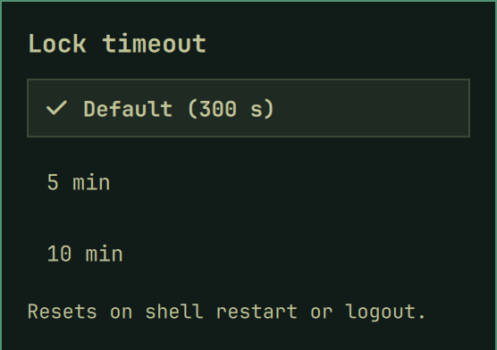

# Lock timeout

An Omarchy bar widget for temporarily extending automatic screen locking at home without leaving a permanent change to your configured default.



## Usage

Click the lock icon in the bar and choose:

| Choice | Automatic lock timeout |
| --- | --- |
| Default | Current configured timeout, displayed in seconds |
| 5 min | 300 seconds |
| 10 min | 600 seconds |

Default and 5 min remain distinct choices even when your configured default is 300 seconds. A checkmark identifies the selection; hovering does not apply it. The bar icon uses the theme accent for an explicit duration.

Up/Down or j/k navigate, Enter/Space apply, Escape dismisses, and Tab/Shift-Tab switch bar popups. All monitor instances share the same selection.

This targets Omarchy 4.5. Choosing 5 min or 10 min writes only `idle.lock` in the existing user `~/.config/omarchy/shell.json` for the session. Choosing Default, disabling, removing, reloading the plugin, restarting the shell, and the next start after a crash all restore the previous `idle.lock`. Moving the widget rewrites `shell.json` but does not reset the selection when `idle.lock` is unchanged.

An armed idle cycle keeps the deadline it was started with, and the new timeout applies on the next cycle, unless restore writes a configured `idle.lock` of 0. On Omarchy 4.5.0-3 the stock lock timer checks live `lockEnabled` when it fires, so restoring 0 while that timer is armed suppresses the pending lock rather than only later cycles. Selection is not blocked because a cycle might be active.

If you or another tool changes `idle.lock` to a value other than the choice this plugin applied, the selection is dropped and the plugin does not write the previous value back over that change. After a completed switch, only the new duration counts as applied, so the replaced duration is left alone.

If `~/.config/omarchy/shell.json` is missing, empty, unreadable, not version 1, or not a JSON object, the plugin refuses the selection and shows a status. It does not create or overwrite that file.

## Requirements and compatibility

- Omarchy 4.5 with its stock shell and existing Quickshell installation. The target release is 4.5.0-3.
- A user `shell.json` at `~/.config/omarchy/shell.json`, version 1, strict JSON. A valid user file replaces defaults entirely; there is no deep merge.
- No additional packages, network access, accounts, daemons, or build step are required by the plugin.

`omarchy.idle` reads `idle.lock` from that file and the shell hot-reloads it. There is no public temporary-timeout API. The plugin writes the existing user file and restores it; it does not replace the idle service. Missing or invalid configuration rejects selections and shows "Shell configuration unavailable."

Default means the configured `idle.lock`, or 300 seconds when that key is absent. 0 is a real "lock disabled" value, not a missing key. If the key was absent, restore deletes the key this plugin added. An empty `idle` object created for that key is removed; other `idle` fields added while the override is active are kept.

## Installation

For a published repository, use `omarchy plugin add` with its public GitHub repository URL and `--enable`. Review the source first: Omarchy plugins execute unsandboxed in the shell, and a longer lock timeout increases unattended access time.

To install from an inspected local checkout, first back up `~/.config/omarchy/shell.json`. If the destination already exists, confirm it belongs to this plugin and preserve any local edits before replacing files. From the repository root:

```sh
omarchy plugin validate "$PWD"
mkdir -p "$HOME/.config/omarchy/plugins/local.lockscreen-config"
cp manifest.json Service.qml Widget.qml LockTimeout.js "$HOME/.config/omarchy/plugins/local.lockscreen-config/"
omarchy-shell shell rescanPlugins
omarchy plugin enable local.lockscreen-config --section right
```

The supported enable command preserves other widgets/settings. Choose placement with `omarchy bar move`; for example, when `omarchy.power` is present:

```sh
omarchy bar move local.lockscreen-config --section right --after omarchy.power
```

For local code updates, repeat validation, the copy, and rescan. For git-managed installs, use `omarchy plugin update local.lockscreen-config`. Reloading resets the selection to Default and restores the previous lock when the file still matches the applied choice. No edits to `/usr/share/omarchy/` are needed.

## Disable or remove

```sh
omarchy plugin disable local.lockscreen-config
omarchy plugin remove local.lockscreen-config
```

Disabling, removing, or reloading destroys the service, which restores `idle.lock` when the file still matches the applied choice. It does not overwrite a lock value changed by someone else. The remove command manages the plugin directory and layout entry. It does not remove unrelated plugins or reset the bar.

## Configuration and permissions

The plugin ID is `local.lockscreen-config`; there are no custom settings. While a duration is selected, the plugin updates only `idle.lock` in the existing user `shell.json`, preserving every other key, `idle.screensaver`, and the bar layout. It records the override in `~/.local/state/omarchy/local.lockscreen-config.json` before writing `shell.json`, and clears that state when the override ends. It does not create `shell.json`, invoke commands, or access the network. Normal Omarchy install/enable/move/remove commands manage the plugin files and bar entry separately.

This is not a lock-security enhancement. Existing inhibitors or stay-awake state can still prevent automatic locking. Marketplace listing or automated checks are not a security audit or guarantee.

## Verification

Ownership regression tests call the plugin's lock-timeout decisions with fixture documents. They do not read or write the home directory. They cover preservation of unrelated `shell.json` keys and screensaver timing, foreign lock values left untouched on restore, removal of an `idle.lock` key that was absent before the override, 5 min remaining distinct from Default when the configured lock is 300 seconds, refusal to write a missing or invalid user file, a completed switch whose journal matches only the new duration, and a failed commit of that journal keeping the pending record. With QtTest and the Qt 6 QML test runner installed, run from the repository root:

```sh
/usr/lib/qt6/bin/qmltestrunner -platform offscreen -input tests
```

QtTest is a development-only dependency, not a plugin runtime requirement. A timed lock event, logout/reboot, and additional monitors were not exercised for this change.

## License and publication

[MIT](LICENSE). Public attribution is **Lock timeout contributors**; no personal author name is included.

See [PUBLISHING.md](PUBLISHING.md) for the official marketplace requirements, chosen category/tags, release checks, and submission process.
